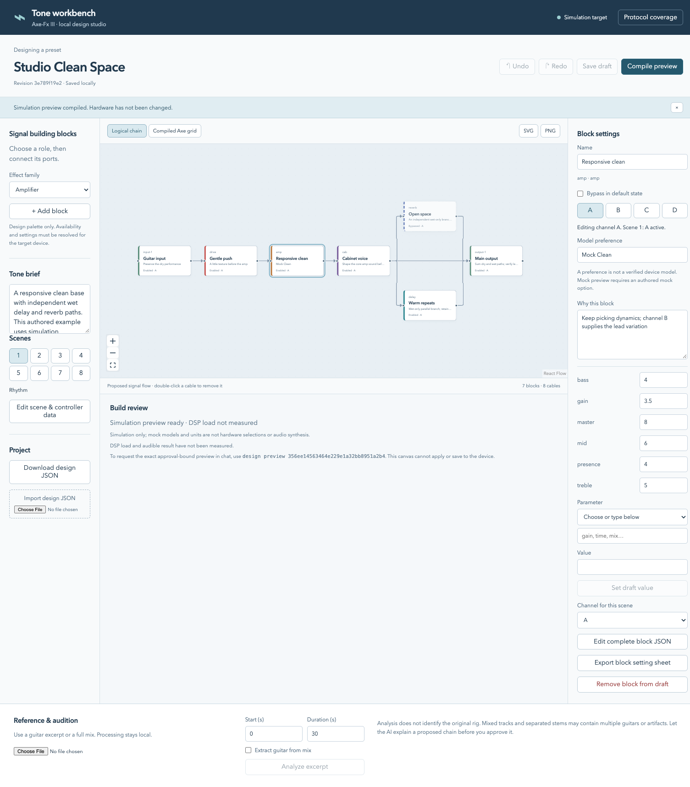

> Native replacement development is on `feat/axe-studio-native`. See [native status](native/README.md) and the [approved contract](todo/NATIVE_APP_PLAN.md). The native app is not yet an acceptance candidate. The legacy instructions below remain available during development.

# Axe-Fx III Python CLI and AI skill

Design, visualize, and inspect Axe-Fx III presets with an AI skill, a Python
backend, and a local browser workbench. Version **0.2.0** includes revisioned
designs, interactive routing, scene and block inspectors, image exports, and
local audio-reference analysis. Codex and Claude Code use the same services
through `python tools/axefx.py`.

## How you use the skill and app

```text
Open workbench → backend reads Axe-Fx III over USB → inspect captured preset
       │
       └→ chat with Codex → review proposed changes → accept a local draft
```

1. Connect and power on your Axe-Fx III, then select the preset you want to work
   on. Launch the workbench with the `ui` command below. The browser opens while
   the backend connects and reads the current preset automatically.
2. Inspect its routing and available block settings. Unknown settings are marked
   explicitly. Use **Refresh from Axe-Fx** after changing the device; previous
   captures and projects stay stored locally.
3. Click **Connect Codex**, then describe the sound you want in the app's chat.
   Select a block to give it context, or attach an audio analysis summary.
4. Review the AI's proposed draft differences and choose **Accept draft changes**
   or **Reject changes**. You can also edit the canvas and save a revision yourself.
   Draft acceptance does not send changes to the device.
5. Use Axe-Edit or the device controls for unsupported hardware edits and saving.
   Play and listen, refresh the capture, and continue refining with the AI.

**Current hardware scope:** USB preset geometry is readable. Full preset
construction, model/scene/channel/modifier/controller writes, complete backup,
and device saving are unresolved. Six recovered amp setters remain
hardware-unverified. The workbench is useful for inspection, design, and review;
it does not automatically transfer a complete draft to the Axe-Fx.

The embedded chat connects to your locally installed Codex CLI using its
configured sign-in and model. Codex CLI **0.163.x** is the currently supported
App Server contract; incompatible versions leave preset inspection available.
There is no separate AI API-key field in the workbench. External Codex and Claude
Code sessions can also use the skill against the same saved revisions.



*Workbench interface illustrated with an authored design, not a live device
capture. Real captures retain unknown settings instead of inventing values.*

## Quick start

Run from this checkout with Python 3.11 and optional `uv`:

```sh
uv venv --python 3.11 .venv-cli
uv pip install --python .venv-cli/bin/python -r config/requirements/cli.txt
source .venv-cli/bin/activate
cd web
npm ci
npm run build
cd ..
python tools/axefx.py --state-dir .local/studio ui
```

Build the UI with Node.js 22 and npm. Connect the Axe-Fx by USB before launching;
install the Fractal driver if your platform requires it. If multiple MIDI pairs
are available, select the Axe-Fx input/output in the UI. Connection failures show
a retry action and never substitute simulated data.
For pip, Windows, and full manual commands, see [the CLI guide](docs/CLI.md).

## Install and use the AI skill

| Client | Project skill | Invocation |
|---|---|---|
| Codex | `.agents/skills/axefx-preset/SKILL.md` | `$axefx-preset` |
| Claude Code | `.claude/skills/axefx-preset/SKILL.md` | `/axefx-preset` |

[Installation instructions](docs/SKILL_INSTALLATION.md) cover project-local setup,
personal installation and optional plugins for both clients. Start with:

> Open the workbench for my connected Axe-Fx III using `.local/studio`. Help me
> inspect its captured routing and refine a warmer clean tone. Keep unknown
> settings explicit and show proposed draft changes for review.

## Open and use the browser UI

Run `python tools/axefx.py --state-dir .local/studio ui` after the setup above.
The server opens a token-protected session on `127.0.0.1` before reading the device;
keep its terminal running. Ctrl+C stops it. Use `ui --no-browser` to print the
session URL instead of opening it automatically.

The connection strip shows preset identity, active scene, capture time, and errors.
**Refresh from Axe-Fx** reads a new snapshot and creates a new project. If you have
unsaved changes, choose to save or discard them first. Captures are snapshots,
not a continuously synchronized view of the device.

- Add and drag blocks, connect ports, or double-click a cable to remove it.
  Undo/redo applies to draft edits.
- Select a block to inspect available parameters and edit proposed settings.
  Scene/channel controls keep unobserved values marked **Unknown**.
- **Save draft** creates an immutable revision shared with the AI.
  **Compile preview** reports target support and USB construction blockers.
- Switch between the logical draft and captured physical grid. Export SVG/PNG
  diagrams and block setting sheets without inventing missing values.
- Chat directly with Codex below the canvas. Responses stream into the panel;
  **Stop response** interrupts a turn. The project's conversation survives a
  browser reload and resumes when reconnecting Codex.
- Review proposed differences before accepting an AI revision. If manual edits
  made it stale, save your draft and ask for a new proposal.

Use the same state directory for external CLI/skill sessions. To reopen a saved
project without a new capture, run `design open PROJECT_ID` with that directory.
The UI has no MIDI apply or device-save endpoint. Its Codex tools are scoped to
inspection, analysis summaries, validation, and draft proposals.

Logical canvas positions are independent of physical grid coordinates. Concurrent
chat/browser saves detect revision conflicts and preserve the unsaved browser
draft for download.

See [the designer guide](docs/DESIGNER.md) for the full design and approval contract.

## Local audio references and A/B listening

Install optional measurements into the Python environment that runs the UI:

```sh
uv pip install --python .venv-cli/bin/python -r config/requirements/audio.txt
# Optional CLI PNG export (browser PNG export does not need this):
uv pip install --python .venv-cli/bin/python -r config/requirements/visual.txt
# Optional guitar extraction from a mixed recording; large model runtime:
uv pip install --python .venv-cli/bin/python -r config/requirements/separation.txt
```

Restart the workbench after installing dependencies. In **Reference & audition**,
choose a local WAV/FLAC, set an excerpt of up to 120 seconds, and analyze it.
Optional guitar extraction downloads model weights and processes audio locally.
Listen to the extracted stem before using it as a target, then attach the analysis
to the design for the AI to review. Import a recording of your playing for
comparison and A/B listening with attenuation-only RMS level matching.

Recordings are stored locally and are not uploaded by this backend. Chat sends
your messages, relevant preset context, and attached analysis summaries to the
configured AI service. Measurements describe spectral balance, dynamics, and
clipping; they do not identify an exact
rig or establish tone-match accuracy. Automatic reamping and parameter search
are not enabled. [Audio workflow and model provenance](docs/DESIGNER.md#local-audio-reference).

## Capabilities and limits

| Area | Current support |
|---|---|
| AI + browser authoring | Embedded Codex chat, streamed responses, reviewable draft differences, and shared revisions for blocks, cables and performance settings. |
| Captured USB state | Read-only preset geometry, shunts, and physical cable branches/merges; unobserved settings remain unknown. |
| USB editing | Six statically recovered amp setters remain hardware-unverified; full structural construction and save are blocked. |
| Protocol/editor evidence | Public MIDI coverage inventory, offline decoding, read-only local Axe-Edit inspection and cache import. |
| Audio | Local measurements, optional guitar separation, stem audition, and descriptive A/B comparison. |

```sh
python tools/axefx.py protocol coverage
python tools/axefx.py protocol inspect-editor --app '/Applications/Axe-Edit III.app'
```

Protocol inventory is broader than executable CLI support. Imported editor
catalogs preserve evidence but do not unlock unverified hardware commands.

USB retrieves grid positions, shunts, and physical cable branches/merges alongside
recovered public and active-amp reads. Full-preset snapshots and structural
editing remain unresolved. Check capabilities before planning device changes.

Draw the connected device's current grid without changing the preset:

```sh
.venv-cli/bin/python tools/axefx.py --format text preset geometry
```

The skill includes [diagram and tone-placement guidance](plugins/axefx/skills/axefx-preset/references/routing.md).

The bundled catalog is development data, not a complete vendor model/parameter
list. It must not be treated as a source of verified hardware model selections. See [the CLI guide](docs/CLI.md)
and [provenance](docs/PROVENANCE.md) for coverage and repository boundaries.
No project software license is selected yet.

## Repository layout

```text
config/                 dependency lists and pytest configuration
src/axefx_cli/          Python library and authored mock definitions
tools/axefx.py          direct CLI entrypoint
tests/                  mock/replay tests and authored synthetic fixture
plugins/axefx/          shared skill and both plugin manifests
web/                    React/React Flow browser workbench
docs/                   guides, simulation example and UI screenshot
.local/                 ignored state and cache
```

The root contains this README plus the folders above. Hidden Git/client metadata
and the existing Python environments stay in their conventional locations.
Generated reports, local recordings, model weights, and device captures stay in
ignored local storage. Copied vendor binaries/resources, firmware, and bulk
catalogs remain outside this Git tree.

## Development checks

```sh
uv pip install --python .venv-cli/bin/python -r config/requirements/dev.txt
.venv-cli/bin/python -m pytest -c config/pytest.ini --rootdir=. -q
```

Run from the repository root; the explicit config path keeps pytest settings
under `config/`. Tests use mock/replay and injected transports, without USB.
Cross-platform CI is configured; remote execution is unverified. For frontend
changes, run `npm run build` and `npm test` from `web/`.

## External Software

| Dependency | Version | Source | Purpose |
|---|---|---|---|
| Python | 3.11 baseline | [python.org](https://www.python.org/) | Direct CLI runtime; no application installation. |
| filelock | `>=3,<4` | [filelock](https://py-filelock.readthedocs.io/) | Cross-process CLI operation lock. |
| platformdirs | `>=4,<5` | [platformdirs](https://platformdirs.readthedocs.io/) | Platform-specific artifact directories. |
| python-rtmidi | `1.5.8` | [maintainer documentation](https://spotlightkid.github.io/python-rtmidi/rtmidi.html) | Native MIDI transport; imported lazily for USB use. |
| uv | optional; locally `0.12.1` | [Astral uv](https://docs.astral.sh/uv/) | Environment/dependency setup; not required at CLI runtime. |
| Codex CLI / desktop client | CLI `0.163.x` for embedded chat; optional for inspection | [Codex](https://developers.openai.com/codex/) | App Server for embedded chat; also hosts the external skill. |
| Claude Code | optional; syntax checked with `2.1.296` | [Claude Code](https://code.claude.com/docs/en/overview) | AI host for the Claude skill; not needed for manual CLI use. |
| pytest | `>=8,<10`, development only | [pytest](https://docs.pytest.org/) | Mock/replay test runner. |
| PyYAML | `>=6,<7`, development only | [PyYAML](https://pyyaml.org/) | Skill metadata validation. |
| Fractal USB/MIDI driver | platform/vendor-specific | [Fractal downloads](https://www.fractalaudio.com/axe-fx-iii-downloads/) | Windows device access; CLI does not install drivers. |
| Node.js / npm | Node 22 CI baseline; npm lockfile | [Node.js](https://nodejs.org/) / [npm](https://docs.npmjs.com/) | Build the optional frontend; Python serves its output. |
| FFmpeg | optional separation runtime; system version | [FFmpeg](https://ffmpeg.org/) | Audio tooling for the optional separation runtime. |
| React / React Flow | locked in `web/package-lock.json` | [React](https://react.dev/) / [React Flow](https://reactflow.dev/) | Optional local visual designer. |
| Vite / TypeScript / Vitest | locked in `web/package-lock.json` | [Vite](https://vite.dev/) / [TypeScript](https://www.typescriptlang.org/) / [Vitest](https://vitest.dev/) | Frontend build and graph tests. |
| NumPy / SciPy / soundfile | `>=2,<3` / `>=1.14,<2` / `>=0.13,<0.14`; optional | [NumPy](https://numpy.org/) / [SciPy](https://scipy.org/) / [soundfile](https://python-soundfile.readthedocs.io/) | Local audio decoding and measurements. |
| audio-separator | `0.41.1`, CPU extra; optional | [maintainer repository](https://github.com/uziproj/audio-separator) | Local guitar extraction with `htdemucs_6s.yaml`; musical quality needs listening acceptance. |
| Pillow | `>=11,<14`; optional | [Pillow](https://pillow.readthedocs.io/) | CLI PNG export without a native Cairo dependency. |

