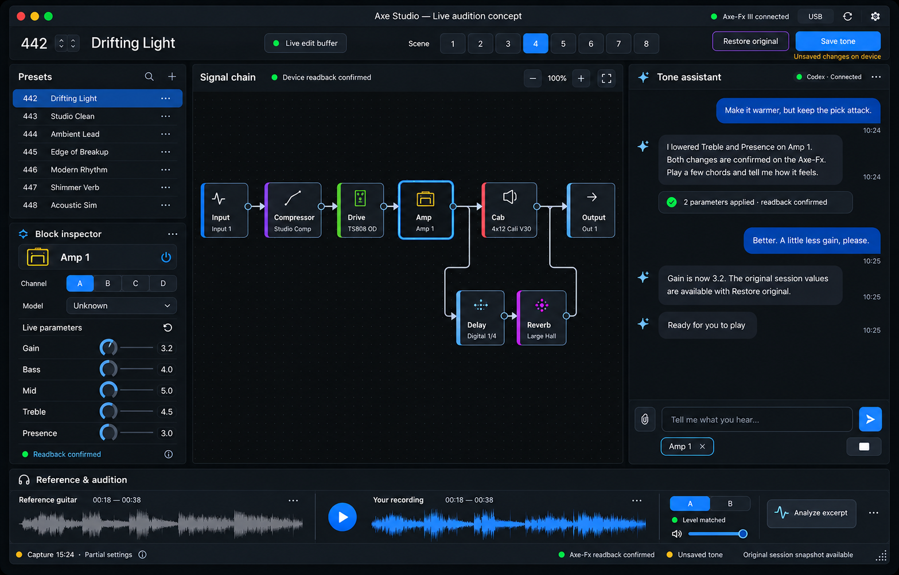

# Axe Studio: native desktop app and live audition

Status: proposed implementation plan, 2026-10-17. Native application coding is
paused pending review of this plan. The UI concept is approved; architectural
defaults below are proposals, not claims about completed implementation.



## 1. Intent and acceptance

Build one installable desktop application for macOS, Windows and Linux. Opening
it starts its internal backend, connects the selected device target (Axe-Fx III
or an explicit test mock), and reads its preset. Only then does it ask the user
to choose Codex or Claude, connect that agent, and load the app skill.
The user should not run a terminal, start a web server, install Python, or copy a
skill into another application to use the packaged desktop app.

The central musical workflow is:

```text
User direction -> agent -> validated parameter transaction -> Axe-Fx edit buffer
      ^                                                        |
      +---------------- user plays and gives feedback <---------+

                        Save tone / Restore original
```

Supported parameter adjustments following the user's direction apply immediately
and are read back. There is no per-adjustment draft acceptance panel. Saving to
the device is a separate user action; restoring returns the session's changed
values to their original state. Unsupported actions remain unavailable rather
than being presented as successfully executed proposals.

A working UI, a simulation, and a read-only capture do not establish that live
writes, restoration, or saving work. Full release acceptance requires the gates
in section 10. The image is a style/layout reference: its model names, numbers,
preset bank, topology and confirmation labels are illustrative.

## 2. Constraints and architecture decisions

### Desktop UI and embedded backend

Use Rust with Iced 0.14.0 as the initial UI baseline, native desktop rendering and
a custom Canvas for routing. Pin Cargo dependencies and commit Cargo.lock. There
is no webview, HTML UI, browser, or dependency on the React workbench at runtime.
Use Iced's standard controls styled with shared color/spacing/type tokens; custom
rendering is limited to effect cards, cables, knobs and waveforms. These are
native-rendered toolkit controls, not wrappers around each OS's stock widgets.

For release 1, retain the existing Python domain/device services in a bundled,
app-owned worker executable. The Rust executable owns the native window and
supervises the worker; the worker owns device sessions, transaction authority,
agent adapters and durable domain state. This embeds the backend in the product,
not in the Rust address space. Users install one app and no Python interpreter.
A full Rust protocol rewrite is deferred; an eventual migration must preserve
the same contracts and pass parity tests. Do not create parallel MIDI owners.

```text
Installed Axe Studio application
|
+-- Rust / Iced native window and process supervisor
|        |
|        +-- private stdio JSON-RPC requests, replies and events
|                 |
+-- Bundled Python worker (single domain/session authority)
         +-- serialized MIDI service -> Axe-Fx III
         +-- transaction journal and original-value baseline
         +-- Codex adapter -> Codex App Server
         +-- Claude adapter -> Claude Agent SDK
         +-- local audio jobs and artifacts
         +-- bundled app skill and scoped tool registry
```

The application owns all worker lifetimes. It starts the worker automatically,
checks readiness, and closes it on normal shutdown. Provider runtimes may be
separate child processes; the app still manages their sessions. A locally
installed supported Codex CLI is a provider prerequisite, not a separate service
the user must start. Missing provider prerequisites show a setup action.

### IPC instead of an HTTP server

Use newline-delimited JSON-RPC 2.0 over inherited stdin/stdout pipes between the
Rust app and its worker. This needs no port, browser token, firewall exception,
HTTP framework, or local network discovery. Reserve stdout for protocol frames;
write redacted diagnostic logs to stderr.

- Negotiate `protocol_version: 1` and capabilities in `initialize`; incompatible
  versions fail with an upgrade message before device mutation.
- Correlate replies with request IDs. Events carry a sequence number and relevant
  session/revision/transaction/turn IDs; reconnect requires a fresh state read.
- Limit frames to 4 MiB and user messages to 12,000 characters. Large audio stays
  in local storage; use opaque artifact IDs in IPC.
- Return long-running operation IDs promptly and stream progress/completion.
  Bound queues; never drop transaction outcomes. UI may coalesce display-only
  meter updates. Stdio EOF terminates the session and stops new writes.
- Do not expose arbitrary shell, path-reading, raw SysEx or general RPC forwarding.

HTTP is not part of this desktop architecture. Existing CLI/browser interfaces
remain compatible, but do not become the desktop app's service boundary.

## 3. Native UI/UX contract

Use the approved image for visual hierarchy: black/charcoal surfaces, readable
neutral text, restrained blue focus/action colors and effect-family edge colors.
Use platform window controls; do not imitate macOS traffic lights on Windows or
Linux. Fonts and icons ship with the app or use available platform fonts.

At a minimum client area of 1280 x 850 logical pixels, all regions remain visible:

- Fixed top device/preset bar: connection status, selected preset, observed scene,
  agent selector, Restore original and Save tone.
- Main horizontal split: left preset navigation/inspector (minimum 240 px),
  central graph (minimum 460 px), right chat (minimum 340 px).
- Left vertical split: preset navigation header/list and block inspector. Keep
  both visible; scroll inside each region when needed.
- Main area minimum height 540 px. Chat reserves at least 110 px for its composer;
  history scrolls independently. The graph pans/zooms and can fit its content.
- Full-width audio strip, minimum 130 px, plus a fixed status bar. A compact
  presentation preserves its transport, A/B and analysis controls at minimum size.

### User-repositionable workspace

The arrangement above is the default preset, not a fixed layout. Preset navigation,
block inspector, signal chain, agent chat and audio audition are five independent
dockable panes. Drag a pane header to move/swap it or dock it beside/above/below
another pane; drag splitters to resize. The user can place chat on the left,
move the inspector to the right, or put audio above the graph. Use a shared
workspace layout model with stable pane IDs and a split-tree of orientation and
ratios; feature widgets do not embed their own absolute screen positions.

Keep all five panes visible in the main window. Release 1 does not use tab stacks,
auto-hide panels, hidden panes or floating windows. The device/preset toolbar,
Save tone, Restore original and status bar are fixed global chrome. Pane movement
never resets chat, selection, audio position, session state or pending operations.
Offer keyboard-accessible move/swap actions alongside pointer drag handles.

Each pane declares its minimum usable size. Validate the entire proposed split
tree against the available client area before accepting a drop or restoring a
saved layout. Invalid drop zones are disabled with a minimum-space explanation;
retain the original layout rather than allowing overlap, vanishing panes or
shrunk text. Users may enlarge the window to enable arrangements that do not fit
at minimum size. Enforce layout-derived window minimums when resizing splitters.

Persist the versioned layout, ratios and window bounds in per-user app settings,
independent of project/device/provider data. Save on completed layout changes.
Restore and clamp to current display bounds and scaling. If a prior layout no
longer fits, fall back to the default visible layout and keep a recoverable copy
of the preference; never leave content off-screen. Provide Reset layout and named
user layout presets. Reject malformed layouts with duplicate/missing pane IDs.

No whole-window scrolling or navigation hides the chat/canvas. Larger windows add
useful working space. Verify minimum sizes against real text, DPI and assistive
technology before the layout gate. Screens smaller than the supported minimum
are outside release-1 layout support.

The graph shows device routing, with shunts, wires, branches/merges and unknown
IDs preserved. Canvas dragging changes view layout only until structural writes
are validated. Parameter controls show pending/readback/error states and distinguish
unknown from zero/off/channel A. Never show a simulated vendor model as a real one.
Preset navigation lists observed/current and recent local captures initially;
only advertise a complete device bank after its enumeration is verified.

Remove proposed-value review cards and Accept/Reject draft buttons from the live
workflow. Applied-change summaries belong in chat and an activity history. Chat,
manual controls and original-value restoration use the same backend writer.

### Modular effect-block widgets

Keep effect presentation independent of the app shell, agent adapters and MIDI
transport. Register built-in effect-family widgets through an `EffectWidgetRegistry`
keyed by semantic effect type, with a generic unknown-effect fallback. Release 1
uses internal modules, not downloaded executable UI plugins or per-preset code.
Adding an effect presentation must not require rewriting the graph, chat or shell.

- `EffectBlockModel` is a read-only view model: stable block ID, observed family,
  label, ports, position, channel/bypass with explicit unknowns, parameter
  descriptors, confirmed/pending values and supported operations. It contains no
  provider SDK or raw MIDI identifiers used for dispatch.
- A reusable `EffectCard` owns common selection, focus, label, port and state
  presentation. A family module supplies icon/color, compact content and optional
  specialized inspector sections; a shared inspector/control library handles
  knob, toggle, enum and numeric controls with units/ranges from verified profiles.
- Presentation emits typed intents such as SelectBlock, AdjustParameter and
  BeginCableDrag. The controller maps these to the domain service. Widgets never
  write MIDI, invoke an agent, persist originals or maintain a competing copy of
  confirmed device state.
- `RoutingCanvas` owns graph coordinates, camera, hit testing, selection and
  composition. Cable rendering is a separate component. Widget-local transient
  state (hover/drag/focus) is distinct from backend parameter/session state.
- Shared theme tokens determine colors, typography, spacing and interaction
  states. Unknown effects still show their real ports/placement and observed
  values without inventing an editable vendor parameter definition.

### Flexible patch cables and gravity

Use a separate `CableRenderer`/`CableSimulation` module for flexible, guitar-style
patch leads. Render a soft jacket/highlight with visible plugs at the block ports.
Cables hang under visual gravity and swing/settle when blocks or cable endpoints
move. Their physics does not model or change audio, signal latency or DSP.

Represent each cable as a bounded particle chain with fixed endpoints and
position-based/Verlet distance constraints. Use a fixed simulation timestep,
bounded solver iterations and damping. Derive resting length from endpoint
separation plus controlled slack; keep stable cable IDs across view changes.
Compute physics in canvas coordinates, independent of zoom and display scaling.
Wake simulation for relevant pointer/layout events and stop repainting once
settled; do not run an idle 60-fps loop. Clamp elapsed time after suspend/resume
so cables do not jump or become unstable.

Draw cables below effect cards and plugs above their ports, constrain sag to the
visible graph working area, and highlight the hovered/selected route. Cable hit
tests follow the displayed curve. Keep a non-animated Simple cables mode and
respect reduced-motion preferences. The accessible connection list remains
available regardless of the rendering mode. Prioritize routing legibility over
physical realism when several leads cross.

Dragging a loose end shows a temporary lead attached to the pointer; releasing
on an invalid port cancels it and restores the original cable. A valid drop emits
a typed routing intent only. Until structural USB changes are validated, show the
capability reason and retain the device's existing routing. Animation, node
movement or an attractive plug must never imply an unsupported device edit
succeeded. The renderer consumes authoritative edges and transient drag previews;
it never creates domain connections by itself.

## 4. Startup, connection and lifecycle

Every launch follows this visible state machine:

```text
Open native window -> start bundled worker -> select/connect target
                                         |-> Axe-Fx III (USB, default)
                                         |-> Test mock (explicit selection)
                         |
                  read preset and capabilities
                         |
                  choose Codex or Claude
                         |
             authenticate/connect -> load app skill -> session ready
```

Show the window immediately. The initial connection screen offers Axe-Fx III
and a clearly marked Test mock target. Only USB is the default. An unambiguous
Axe-Fx input/output pair can connect automatically; otherwise show endpoint
selectors. A failed USB connection offers retry or explicit target selection,
never an automatic mock fallback. Mock targets use separate artifacts and a
persistent Simulation badge, and never open real MIDI ports.

After a successful preset read, display the Codex/Claude chooser on every launch.
A remembered provider may be highlighted but is not connected until chosen.
Show availability, authentication/setup needs and supported capabilities for
both options; do not launch either agent before target readiness and selection.
Connection and preset inspection stay usable while the chooser is visible.
A partial but valid read can proceed to agent choice with its capability gaps
clearly shown; unknown data does not become a fabricated complete preset.

The first device read establishes current routing, preset/scene/channel context,
known parameters and capability gaps. Missing settings remain unknown. Poll
lightweight context while idle on the serialized device queue, once per second;
coalesce the poll with pending transaction checks and stop it on disconnect.
A transaction always performs its own authoritative context/value checks.

There is one active agent per live device session, not two competing writers.
Provider switching interrupts the old turn, revokes its tool capability and
creates/resumes the selected provider's own conversation. Original values and
device state remain backend-owned. Switching target ends the old device session
only after its save/restore/leave decision, cancels old provider work and requires
a fresh preset read and provider choice. Disconnection revokes write authority;
a connected agent cannot act until device context is reconciled explicitly.

Provider absence or authentication failure must not prevent device inspection,
manual supported controls, restoration, or local audio playback. Surface Setup,
Retry and offline states. Network/model errors cannot silently swap providers.

Before closing with app-made device changes, offer Save tone, Restore original,
Cancel, or an explicitly labeled Leave unsaved on device. If save/restore is
unavailable or fails, retain recovery records and let the user choose how to
proceed; never claim that closing persisted or restored the tone. Unexpected
worker exit stops UI commands, retains the last view as stale and exposes
recovery; never replay a write automatically after restart.

## 5. Agent adapters and automatic skill loading

The skill is versioned musical/workflow guidance. It does not itself establish
connectivity or grant authority. Callable host tools provide the connection and
backend code enforces every invariant independently of model instructions.

Bundle an `axefx-live` app skill and its required references with the installed
worker. It describes live audition, capability checks, unknown values, listening
iterations and the separate save/restore actions. Keep the existing external
CLI skill compatible; its preview-based command workflow is not silently changed.
The app skill must not tell the embedded agent to bypass the broker by launching
CLI commands or sending MIDI directly.

### Explicit skill ingestion before the first user turn

Both provider adapters must load the bundled skill during app-session startup,
not wait for the model to decide that it might be relevant. After provider choice:
verify the bundled skill identity/version, register scoped tools, establish the
provider session, explicitly invoke the skill in a read-only initialization turn,
and only then advertise agent-ready in chat. Initialization is an app lifecycle
event, not a user instruction authorizing parameter mutation; the backend rejects
writes until a genuine user direction or manual-control event establishes scope.

Codex receives `$axefx-live` plus an explicit `skill` input item containing the
absolute bundled SKILL.md path in the initialization `turn/start`. The full skill
is supplied through the documented skill-input mechanism, independently of global
plugin installation. Claude discovers the packaged filesystem skill through the
app-owned project/plugin source, restricts enabled skills to `axefx-live`, and
invokes `/axefx-live` explicitly. Discovery of metadata alone does not mean full
Claude skill content has been loaded; observe the provider's skill invocation/
loading events before readiness. Do not claim Claude supports registering a
skill from a bare in-memory string; its documented SDK skill mechanism uses files.

Display skill name/version and load status in provider details. Loading failure
leaves inspection available and chat in a retryable initialization-failed state;
it never silently switches to a generic unrestricted agent. On resume, verify
session/skill version and reinitialize when the bundled skill changes. Preserve
the conversation and mark the initialization boundary. Provider contract tests
must distinguish discovered, loading, loaded and failed, and prove that startup
cannot trigger a device write. A model's verbal claim that it is ready is not the
sole evidence that skill ingestion succeeded.

### App-owned conversation and provider sessions

The user talks in the native app's chat pane. The app starts/connects the selected
agent, exposes its scoped tools, streams its responses into that pane, and stores
the conversation locally. No separate Codex/Claude window or terminal is needed
for ongoing chat. Provider authentication/setup may require its supported setup
flow; it is not the place where the app conversation is displayed.

The worker owns a durable append-only conversation log with stable conversation,
message, turn, provider-session and event IDs. Record user messages before sending
and assistant/activity events as received; checkpoint streamed output so a crash
retains partial responses marked interrupted. Store results/errors of app tool
calls alongside the turn, redacting credentials and avoiding raw recordings.
Normalized events feed the native view; the UI is not the only copy of history.
No automatic deletion or transcript pruning occurs without explicit user action.

Provider-side history remains provider-owned and may also be persisted by its
runtime; the app does not claim those services store nothing. Associate their
conversation IDs with the local conversation for resume. A browser, terminal or
existing desktop-agent conversation is not silently imported. On app restart,
show local history immediately; resume the selected provider after the required
device connection and user provider choice. Reconcile by stable IDs to avoid
duplicate messages, reissued prompts or replayed tool mutations.

Switching between Codex and Claude retains the visible local transcript, labeling
provider boundaries. Each provider resumes only its own session. Supply a bounded
context summary of intervening user/assistant messages and current confirmed
device state when switching; do not impersonate one provider's session or feed
old tool calls as executable requests. Show clearly whether a turn is running,
complete, interrupted or failed. A disconnected agent leaves chat history readable.

### Modular agent abstraction

Define a provider-independent `AgentAdapter` protocol in the worker. Register
Codex and Claude implementations in an `AgentRegistry` keyed by provider ID.
The Rust chat UI depends only on normalized worker events and provider metadata;
it never imports a provider SDK or switches on provider-specific wire messages.
The device/transaction service has no dependency on a provider implementation.

The adapter contract is:

- `describe()` / `probe()` return provider ID, availability/setup reason and
  supported features without starting a conversation or selecting a device.
- `connect(config)` starts the selected provider runtime; `start_session` and
  `resume_session` bind its conversation to the current app session and skill
  version. `send`, `interrupt` and `disconnect` own turn/session lifecycle.
- `events()` emits normalized connection, authentication, skill-ready, text-delta,
  tool-activity, turn-completed, cancelled and error events with provider/session/
  turn IDs. Translate protocol differences entirely inside the adapter.
- Both adapters receive the same host-owned tool registry and request context.
  They cannot expose extra mutation paths, send raw MIDI, weaken ranges or skip
  session authorization. Optional unsupported provider features are advertised
  as unavailable rather than simulated.
- Persist provider configuration and provider-specific conversation IDs separately
  from the shared device session. Never pass one provider's IDs or credentials
  to another. Require disconnect/cancellation before replacing the adapter.

Keep bundled skill content and shared tool schemas provider-neutral. Each adapter
only translates skill installation/invocation and tool/event transport. Adding a
third provider requires a registry entry and adapter contract tests, not changes
to effect widgets, backend transaction semantics or the chat view.

### Codex

Use Codex App Server over stdio, with initialization, persistent thread IDs,
turn start/interrupt and streamed item events. Register host-defined tools through
`dynamicTools` and handle `item/tool/call` in the worker. Invoke the bundled skill
explicitly using its absolute path; verify skill loading and include the app's
restricted live-session instructions on start/resume.

Begin with the locally exercised Codex CLI 0.163.x protocol contract; add versions
only through adapter compatibility tests. Required controls disable general
command execution, unrelated plugins/connectors, hooks and delegation; use no
execution environments and a confirmed read-only sandbox. Retain the code-mode
host when required to dispatch application tools. Deny unsupported host requests.
If restrictions cannot be established, disable that adapter without enabling a
less restricted fallback. Use supported provider authentication; never copy,
extract or expose a desktop app's credentials.

### Claude

Use the official Python Claude Agent SDK, `ClaudeSDKClient`, streamed messages,
interrupt and provider session IDs. Register the same domain tools with
`create_sdk_mcp_server` in the worker. This is in-process MCP, not a public HTTP
server. Pin the SDK and its compatible runtime in the packaging lockfiles.

Load the app skill from an app-owned filesystem workspace/plugin containing
only the bundled app skill/references. Enable that skill specifically and invoke
it at session start. Do not load arbitrary user/project hooks, plugins or MCP
servers from a repository directory. Restrict built-in tools to the minimal
skill-loading support, confine any necessary Read to the bundled skill directory,
and use a deny-by-default permission callback for all non-app operations.
`allowed_tools` alone is not a sandbox or an exclusive tool list. Test that Bash,
file edits, arbitrary Read, unrelated MCP and delegated agents cannot execute.
If the installed SDK cannot enforce the contract, mark it incompatible.

For a distributable third-party app, default Claude authentication to the SDK's
supported API-key method. Store the secret in the OS credential store, never the
project files, transcript or IPC event log. Do not promise use of Claude Pro/Max
login/rate limits: current Anthropic documentation requires prior approval for
third-party products offering that authentication. After the user chooses Claude,
use configured credentials; show setup when absent. Codex and Claude authentication
are separate and do not share keys or conversation IDs.

### Shared tool surface

Tools call the backend's session service directly. Codex dynamic tools and Claude
MCP tools are adapters to the same registry, not independent implementations.

| Tool | Contract |
|---|---|
| `tone_get_session` | Current device context, observed state, capabilities, last confirmed values, original-value scope and event revision. |
| `tone_get_block` | Read available settings for an observed block/channel; unknowns remain explicit. |
| `tone_get_analysis` | Read an explicitly attached local analysis summary, not raw audio or arbitrary files. |
| `tone_set_parameters` | Apply a typed batch of supported parameter values under the active user direction; return transaction/readback results. |
| `tone_get_activity` | Query transaction status and applied/verified results, including interrupted or failed batches. |

Save and Restore are native UI commands; they are not agent tools in release 1.
The agent may explain them but cannot persist a preset or reset a session on its
own. Host-injected session, generation and user-turn context bind every mutation;
the model cannot invent an authorization/session ID. User requests establish the
scope for their turn and its follow-up iterations, not unrelated autonomous
background changes. Stop invalidates queued agent changes immediately.

## 6. Authoritative live transaction service

Introduce a LiveSession service around the existing typed operation and readback
machinery. Do not sprinkle `approved=True` calls into the browser chat adapter.
Keep the existing external CLI exact-preview approval contract intact; add a
separate app-session authorization path backed by real user-turn/UI events.

Each session has an observed device identity/context, an immutable entry capture,
a lazily extended map of original writable values, a last-confirmed value map,
a monotonically increasing generation, and a durable append-only transaction
journal. Runtime identity is limited to actually verified attributes; existing
endpoint names and the generic `axe-fx-iii` model ID are not a unique device serial.
On reconnect, require explicit context reconciliation before resuming writes.

All manual, agent, refresh and restore operations share a single serialized
writer/reader queue and the same existing cross-process USB lock as the CLI.
No toolkit callback or agent handler opens MIDI directly. A transaction:

1. Checks active session, user direction, expected generation, context, supported
   block/channel/parameter, units/range, and modifier/automation constraints.
2. Reads the originals for newly touched parameters and verifies context/value
   stability. Unknown originals block that target. Durably records original raw
   values before the first write; never replace them with later adjusted values.
3. Records batch intent and idempotency key, computes expected values, and marks
   the transaction started before sending MIDI. Deduplicate the same key; reject
   reuse with different operations. A timed-out result is queried, not retried.
4. Sends validated writes sequentially with per-target context checks and reads
   back their values. Reports Applied only after verification; tolerances come
   from validated wire conversions, not arbitrary UI rounding.
5. Advances the confirmed-state generation and emits a complete result. Never
   describe a partially executed batch as atomic or fully applied.

Coalesce manual continuous-control events to the latest pending value per target
at no more than 10 submissions/second; maintain one in-flight transaction. Agent
batches contain explicit values and run sequentially, bounded to 32 parameter
operations per batch. Backend capability limits may be stricter. UI state follows
confirmed results, with a pending indicator while values are in flight.

On a failure, stop the batch and capture what is readable. Restore only the
values changed by that batch to their pre-batch confirmed values when the same
context is verified; preserve the session-original baseline for the user's
Restore action. If restoration cannot be verified, enter recovery-required state,
stop further writes and retain all raw originals and outcome records.

An external preset, scene, channel, topology or touched-parameter change invalidates
pending work. Surface the conflict and re-read; never overwrite unrelated external
edits or silently treat them as agent changes. External edits outside the observed
scope cannot be claimed as detected. Modifier bindings must be verified/protected
before enabling affected targets; unreliable readback alone is not sufficient.

Session states: connecting -> inspecting -> ready-clean -> applying -> ready-changed.
Failures branch to disconnected, conflict or recovery-required. Save/restore are
exclusive states that reject new parameter batches. Stop cancels queued writes
and prevents subsequent tool calls; an already sent MIDI command must still be
read back or recorded as uncertain before concluding interruption.

## 7. Save tone, Restore original and scope

Restore original means restoring every app-touched parameter to its captured
session original in the same preset/channel context, followed by readback. It
preserves unrelated settings. A parameter map is not a full-preset snapshot;
show its scope honestly. Switching presets with app changes offers the same
Save/Restore/Leave/Cancel choices and does not send a preset-selection command
until the decision and necessary capability checks are complete.

Save tone persists the verified current edit buffer to the selected preset only
following a click, with target/overwrite details shown. It needs recovered wire
semantics and save/reload acceptance. It must not merely write a local JSON file.
After a confirmed save, close that audition baseline and begin a new session
baseline from the saved tone. Restore original then refers to the new baseline.
Do not silently broaden saving to other slots or overwrite destinations.

Current USB code cannot yet perform full saving, reliable complete backup, or
structural/model/scene/channel/controller writes. Keep those controls visible
but disabled with an exact capability reason until their gates pass. Disable
scene switching/model selection as device actions when unsupported. Do not
ship the app as a complete live-audition release while Save/Restore acceptance
is still missing; an internal read-only build must identify itself as such.

## 8. Internal interfaces and compatibility

Keep service methods independent of UI, provider SDKs and transport serialization.
The worker's IPC registry includes initialization/shutdown, application state,
device discovery/capture/refresh, session inspection, parameter transactions,
transaction status, session restore/save, agent connect/send/interrupt, and audio
import/analyze/compare/playback metadata. Runtime methods are advertised only
when implemented; save/restore methods may return capability errors during
staged development. Stable errors distinguish unsupported, context changed,
unknown original, busy, disconnected, readback mismatch and recovery required.

Emit normalized device state, session state, parameter pending/verified, transaction
completion, agent text/activity/error and audio job progress events. Include IDs
so old provider/device events cannot update a new session. The UI derives its
state from snapshots/events; do not maintain a second authoritative parameter map
in the Rust layer. Restart obtains a new snapshot; it never assumes queued edits
were executed.

Preserve existing schema-1.0 artifacts and CLI commands. New live-session records
use a separate versioned artifact kind and do not reinterpret old mock fixtures
or plans as hardware sessions. Preserve all current uncommitted work; do not
remove the browser implementation as part of native migration. Its state and
agent code can inform service extraction but its draft-only permissions do not
become live authorization automatically.

## 9. Packaging, audio and dependencies

Release-1 targets: macOS arm64 and x86_64, Windows x86_64, Linux x86_64 with X11
and Wayland checks. Other CPU targets are deferred; cross-platform does not mean
one executable runs on every OS or architecture. Build on each target OS and
package matching native dependencies. Do not require global Python, npm, uv or a
source checkout on an end user's machine.

Bundle the worker using a standalone directory-style Python freeze (PyInstaller),
its minimal MIDI/domain dependencies, skill assets and version manifest. The Rust
supervisor locates resources relative to the installed app and validates matching
IPC versions. Keep Python and Rust stdout/stderr handling and paths Unicode-safe.
Use native package builds: signed/notarized macOS app/DMG, signed Windows installer,
and Linux AppImage. Signing credentials are release infrastructure requirements;
unavailable credentials yield an internal unsigned build, not a signed release.

Provider executables are discovered/configured by absolute path and launched
without shell interpolation; do not redistribute third-party agent binaries by
assumption. Package the Claude SDK adapter, require its documented compatible
runtime and authentication, and expose a prerequisite/setup check. Optional
large separation dependencies/models are an app-managed download, not a startup
requirement. Record their versions/hashes. Ship measurements/playback separately
from optional guitar extraction.

Use Rust audio playback for the audition strip (rodio/cpal), choosing an available
output device in settings. Decode/downsample waveform previews off the UI thread.
Keep existing local measurement/separation services; raw recordings never become
agent attachments automatically. Send selected measurements and musical context
only. Recording capture and automatic USB reamping are outside release 1; users
import recordings. A/B attenuation-only level matching must remain deterministic.

## 10. Ordered implementation milestones and mandatory gates

### A. Freeze interfaces and prove packaging prerequisites

Record lockfiles, supported provider versions and the release matrix. Build a
minimal native window plus a packaged worker that completes the IPC handshake on
all target OSes. Check Iced text input, custom Canvas, resize and async event
integration. Confirm Codex tool restrictions and Claude skill/tool/authentication
behavior using deterministic harnesses. If a required contract is unavailable,
stop at this gate and revise the plan rather than selecting a hidden fallback.

### B. Native read-only workspace

Implement the effect widget registry, common card/inspector controls, unknown
fallback and decoupled routing/cable modules before specialized family widgets.
Verify gravity cables settle without idle redraw and offer a reduced-motion mode.
Implement the image's layout, context/unknown states, graph selection, inspector,
chat composer and audio-strip shell. Wire real preset capture through existing
services. Verify the default and repositioned layouts at 1280x850, 1600x1000 and maximized, including 100%,
150% and 200% scale, keyboard focus and screen-reader labels. Keep save/unsupported
controls visible and accurately disabled. Exit: real current routing shown without
writes, plus native visual acceptance on all three OSes.

### C. Agent conversation and bundled skill

Implement the shared adapter protocol and registry, then both provider adapters,
device-first startup, an explicit Codex/Claude chooser, skill verification, streamed
messages, stop/retry/resume, bounded tool dispatch and selected-block/analysis
context and durable app-owned chat history. Run fake-provider integration tests and one real read-only conversation
per provider. Reload/restart must retain history without duplicating turns or
resending operations. Exit: both agents can explain the same real capture using
only app-scoped tools. Authentication incompatibilities are reported separately.

### D. Hardware research and live transaction foundation

Recover/validate firmware/profile identity, writable conversion semantics,
modifier protection and original-value reads. Designate a disposable test preset
with a verified restorable backup before setter experiments. Exercise bounded
writes and exact restoration for the existing six amp controls first. Store raw
evidence privately. Extend no further than validated capabilities.

Add transaction queue, baseline, journal, idempotency, stale-context checks,
cancellation and reconnect recovery. Cover partial failure with injected
transports before hardware writes. Exit: physical-device adjustment/readback and
session Restore original pass independently; no corrupted/unrelated state.

### E. Live agent iteration and persistence

Expose `tone_set_parameters` only after milestone D. A real user request drives
one verified adjustment, user audition, feedback and a second adjustment without
per-adjustment acceptance. Check manual controls, agent turns and external CLI
contention cannot race. Stop prevents additional writes; stale turns cannot act.

Recover actual preset-save semantics, verify target/overwrite protections and
save/reload persistence on the designated preset. Exercise Restore, Save, preset
switching and close paths, including disconnected/uncertain states. Exit: the
complete live-audition/Save/Restore workflow is proven; unsupported operation
families remain explicitly unavailable.

### F. Audio, distribution and release acceptance

Integrate waveform/player/level matching, local analysis, explicit summary
attachments and optional separation setup. Complete clean-machine installation
and provider setup, native packaging and shutdown/recovery checks on every
release target. Require read-only and bounded live-MIDI hardware acceptance on
macOS, Windows and Linux; identify any untested CPU variant separately rather
than equating a build with hardware verification.

Publish user documentation around one app launch, provider setup, device
connection, live feedback, Save and Restore. Do not mark the product complete
until all required gates pass and residual limitations are visible to users.

## 11. Test requirements and critical review

Mandatory automated layers:

- Workspace tests cover dragging/swapping every content pane, invalid dock targets,
  splitter minimums, keyboard movement, named layouts/reset, display/DPI changes,
  corrupt/older layout restoration and all-five-panes visibility. Repositioning
  must preserve feature state and in-flight session operations.
- Conversation persistence tests cover reload/restart, partial output after crash,
  provider switching, resume deduplication, readable offline history and no replay
  of user messages or device mutations. Credentials never enter transcripts.
- Component tests prove an effect family can be added through registry/family
  modules without changes to the app shell, chat or MIDI service. Cover generic
  unknown effects and shared inspector controls.
- Cable simulation/rendering tests cover pinned endpoints, stable settling,
  zoom/DPI independence, invalid-drop cancellation, reduced motion and no idle
  repaint. Visual animation cannot create a domain edge or bypass capability gates.
- A shared adapter contract suite runs against both providers: equivalent normalized
  events, skill-ready handshake, interruption, isolation and tool restrictions.
  Startup tests prove no provider is launched before target capture and explicit
  user choice. Mock sessions must open no USB endpoint or reuse live artifacts.
- Rust view/state tests and backend unit tests for generation checks, original
  snapshots, transaction outcomes, conversion validation and recovery records.
- IPC integration tests for frame limits, malformed input, EOF, cancellation,
  bounded queues, worker crashes, duplicate requests and stale event delivery.
- Fake Codex/Claude integrations for skill loading, tool deny rules, streaming,
  auth failures, provider changes, stale turns and unauthorized save/raw MIDI.
- Injected MIDI tests for external context changes, partial writes, timeout after
  send, readback failure, restore failure, unknown originals and idempotency.
- Native interaction/visual checks and clean-package smoke tests across the target
  matrix. Tests must not use a browser as evidence of native UI behavior.
- Compatibility tests for existing CLI/artifacts and local audio semantics.

Manual gates are separate: native layout/keyboard/listening acceptance; actual
hardware writes, original restoration and save/reload; and real provider login,
skill loading and tool calls. No firmware uploads, CAB/NAM uploads, broad
parameter sweeps or unsolicited stored-preset overwrites are part of testing.

Critical review conclusions:

- Toolkit portability does not prove driver/device portability: require per-OS
  packages and MIDI acceptance, including Linux audio/MIDI system dependencies.
- Skills are instructions, not permissions: backend authorization and provider
  tool restrictions are mandatory, particularly for immediate live writes.
- Existing endpoint/model IDs do not uniquely identify hardware: never auto-replay
  recovery across a reconnect based solely on those labels.
- A partial baseline cannot justify full-tone rollback or unsupported structures:
  constrain writes and state the exact protected scope.
- The screenshot is not a specification of verified parameter ranges or topology.
  Inspector data and cables come from capture/profile evidence.
- Original-value preservation must survive worker failure before any write; logs
  and recovery records must never report uncertain outcomes as successful.
- Claude login assumptions can invalidate distribution: use documented API-key
  authentication unless another supported arrangement is established.

## 12. Research basis and review gate

Primary sources consulted for this plan:

- [Iced native UI, responsive layout, custom widgets and async runtime](https://github.com/iced-rs/iced)
- [Iced stable version metadata](https://crates.io/crates/iced)
- [Codex App Server: lifecycle, dynamic tools, streaming and explicit skill input](https://learn.chatgpt.com/docs/app-server)
- [Claude custom tools and in-process MCP](https://code.claude.com/docs/en/agent-sdk/custom-tools)
- [Claude skill discovery and explicit skill scope](https://code.claude.com/docs/en/agent-sdk/skills)
- [Claude SDK overview and third-party authentication boundary](https://code.claude.com/docs/en/agent-sdk/overview)

Repository evidence: `src/axefx_cli/backends.py` provides current capability
boundaries and numeric readback/restoration; `engine.py` provides typed preview,
locking/journal/recovery behavior; `chat.py` is the draft-only Codex prototype.
These are reusable foundations, not the completed native/live implementation.

Only planning documents and the approved concept image are authorized in this
stage. No native app implementation, dependency installation, builds, tests or
device writes are performed for this planning task. Review this plan before
starting implementation. Backend bundling is the default migration choice;
rewriting all device services in Rust is a distinct future scope change.
